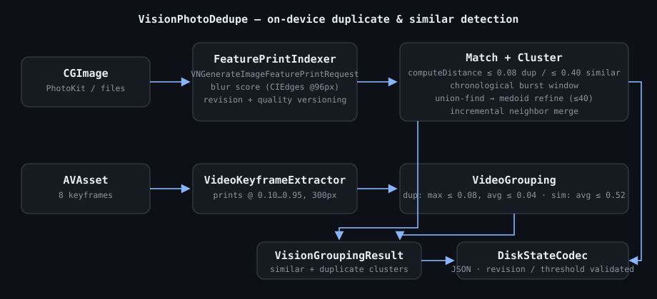

# VisionPhotoDedupe

[](https://swift.org)
[](https://developer.apple.com)
[](LICENSE)
[](https://github.com/nilkanthdesai76/swift-vision-photo-dedupe/actions/workflows/ci.yml)

On-device **similar & duplicate photo/video detection** for Apple platforms, built on Apple's Vision framework (`VNGenerateImageFeaturePrintRequest`). No network, no external model, no dependencies.

Extracted from a production iOS photo-cleaner app and repackaged as a standalone Swift package. AI-based photo sorting is intentionally **not** part of this package.



## How it works

1. **Fingerprint** — each photo is reduced to a Vision *feature print* (a compact descriptor) plus a blur score (CoreImage edge energy).
2. **Match** — prints are compared with `VNFeaturePrintObservation.computeDistance(_:to:)`. Distance `0` = identical; distance `4.0` ≈ 0 % similar.
3. **Group** — matches are clustered with union-find, then each cluster is refined around its *medoid* (the member with the smallest total distance to all others).
4. **Regroup incrementally** — newly added photos are attached to cached groups by comparing only their chronological neighbors, avoiding a full re-scan.

### Thresholds

| Bucket | Rule | Value |
|---|---|---|
| Exact duplicate | distance ≤ `0.08` | ≥ 98 % similar |
| Similar | distance ≤ `0.40` | ≥ 90 % similar |
| Blurry | edge energy < `0.16` at 96 px (near-black frames excluded) | — |

All constants live in `VisionSimilarityConfig` / `VideoFeaturePrintConfig`. Photo grouping additionally uses chronological burst windowing: candidates are compared within a 150-photo hard cap, and the lookahead stops after a 100-photo gap **and** a 6-hour time gap.

### Videos

Videos are fingerprinted by 8 keyframes sampled across the timeline (`0.10 … 0.95`), avoiding start/end black frames. Two videos are duplicates when at least 4 frames compare within `0.08` (max) and `0.04` (average) and their durations match within 0.5 s / 1 %, with a byte-size + duration fallback. Similar videos need an average frame distance ≤ `0.52` within a 100-video / 4-hour chronological window.

## Usage

```swift
import VisionPhotoDedupe

let indexer = FeaturePrintIndexer(diskState: previouslySavedState)

// 1. Fingerprint decoded images (decode via PhotoKit, file URLs, ...).
for (id, cgImage) in decodedPhotos {
    indexer.index(cgImage: cgImage, includeBlurScore: true, for: id)
}

// 2. Group.
let result = await indexer.findSimilarGroups(
    assetIDs: photoIDs,
    creationDates: creationDates,   // chronological burst windowing
    onProgress: { fraction, partial in /* UI */ }
)
for cluster in result.duplicates {
    // cluster.representativeId is the keeper candidate (medoid)
    let others = cluster.members.dropFirst().map(\.identifier)
}

// 3. Later: attach new photos without a full regroup.
if let merged = await indexer.mergeNewPhotosIntoCachedGroups(
    newIDs: newPhotoIDs,
    creationDates: creationDates
) { /* updated groups */ }

// 4. Persist.
let state = await indexer.diskState()
try DiskStateCodec.save(state, to: cacheFileURL)
```

### Wiring to PhotoKit (example adapter)

The package deliberately contains no PhotoKit code. A typical app-side indexing loop:

```swift
let options = PHImageRequestOptions()
options.isNetworkAccessAllowed = false
options.deliveryMode = .highQualityFormat

for asset in assets where PhotoScanEligibility.isEligible(asset) {
    PHImageManager.default().requestImage(
        for: asset,
        targetSize: CGSize(width: 300, height: 300),
        contentMode: .aspectFit,
        options: options
    ) { image, _ in
        guard let cgImage = image?.cgImage else { return }
        await indexer.index(cgImage: cgImage, includeBlurScore: true, for: asset.localIdentifier)
    }
}
```

### Videos

```swift
let rows = videos.map {
    VideoRow(assetID: $0.localIdentifier, creationDate: $0.creationDate ?? .distantPast,
             duration: $0.duration, fileSize: sizes[$0.localIdentifier] ?? 0)
}
var observations: [String: [VNFeaturePrintObservation]] = [:]
for video in videos {
    let frames = VideoKeyframeExtractor.extractKeyframes(from: avAsset, duration: video.duration)
    observations[video.assetID] = frames.compactMap(VideoKeyframeExtractor.computeFeaturePrint)
}
let groups = VideoGrouping.process(rows: rows, observations: observations)
```

## Persistence & invalidation

- Prints are archived (`NSKeyedArchiver`) and versioned by `fingerprintQualityVersion` — bump it when fingerprint computation changes.
- The Vision request `revision` invalidates both prints and cached groups across OS upgrades.
- Cached groups are also validated against the thresholds and the indexed-ID set; use `loadCachedGroupsLenient()` when a few indexed IDs may be missing.
- `FeaturePrintIndexer.shouldPruneStalePrints(existingIDs:decodeIDs:)` guards against wiping the whole index when only a subset of IDs was scanned.

## Requirements

- iOS 15+ / macOS 12+
- Swift 5.9+ (Swift 6 concurrency-safe)
- No third-party dependencies

## Installation

Add via Swift Package Manager:

```swift
dependencies: [
    .package(url: "https://github.com/<your-org>/swift-vision-photo-dedupe.git", from: "1.0.0")
]
```

## Testing

```bash
swift test
```

Tests run real Vision feature-print computation (macOS required).

## License

MIT — see [LICENSE](LICENSE).
